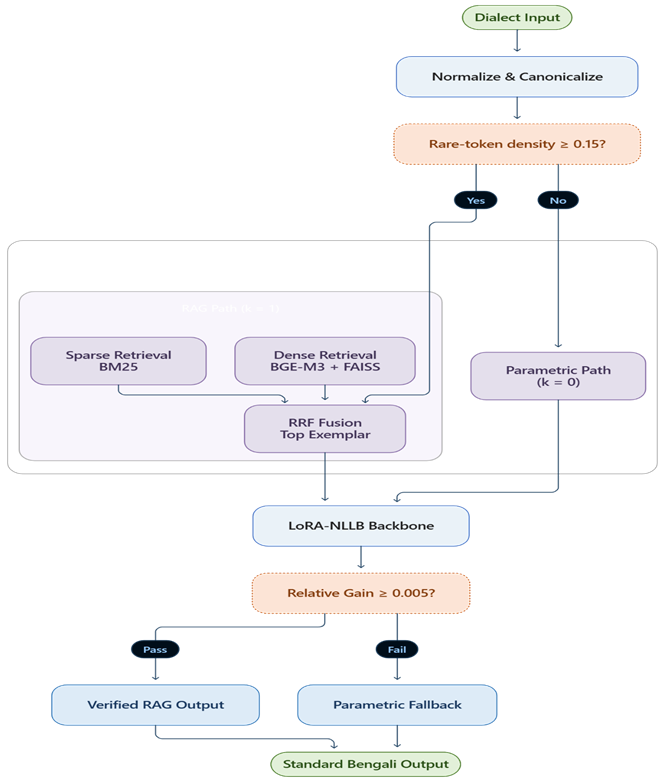

# Bridging Parametric Learning and Dynamic Non-Parametric Retrieval: A Verified Framework for Bangla Dialect Translation

[](https://www.python.org/downloads/)
[](https://pytorch.org/)
[](https://huggingface.co/)
[](https://github.com/huggingface/peft)
[](https://developer.nvidia.com/cuda-toolkit)

> **Undergraduate Thesis (Course Code: ECE 452)**  
> **Department of Electronics and Communication Engineering (ECE)**  
> **Hajee Mohammad Danesh Science and Technology University (HSTU)**, Dinajpur-5200, Bangladesh  
> *Academic Year: 2026 | Session: 2021 | Submission Date: October, 2026*

---

## 👥 Authors & Thesis Details

### Submitted By
* **Md. Tayyab Ameri Turan** — *Student ID: `2102112`* — Department of ECE, HSTU
* **Md. Al – Imran** — *Student ID: `2102129`* — Department of ECE, HSTU
* **Tawhid Hasan Santo** — *Student ID: `2102155`* — Department of ECE, HSTU

### Supervision
* **Supervisor**: **Dr. Nasrin Sultana**, Professor, Department of ECE, HSTU
* **Co-Supervisor**: **Dr. Tangina Sultana**, Professor, Department of ECE, HSTU

### Academic Affiliation
* **Department**: Department of Electronics and Communication Engineering (ECE)
* **Degree**: Bachelor of Science in Electronics and Communication Engineering (B.Sc. Engg. in ECE)
* **Institution**: Hajee Mohammad Danesh Science and Technology University (HSTU), Dinajpur-5200, Bangladesh

---

## 📑 Abstract

Bengali regional varieties like **Chittagonian** (spoken by over 13 million people in southeastern Bangladesh) and **Sylheti** (spoken by over 11 million people in northeastern Bangladesh and international diaspora communities) diverge sharply from Standard Bangla in phonology, morphosyntax, and vocabulary. This linguistic divergence causes severe tokenization fragmentation and out-of-vocabulary (OOV) errors in automated translation systems. While compact sequence-to-sequence (Seq2Seq) models suffer from severe prompt pollution when presented with verbose multi-exemplar retrieval prompts, standalone parametric fine-tuning frequently misses rare, long-tail dialectal lexemes.

To resolve this trade-off, this thesis proposes an **Architecture-Aware Verified Hybrid Translation Framework** that bridges parameter-efficient adaptation with dynamic non-parametric exemplar retrieval. The pipeline couples deterministic graphemic canonicalization with an automated lexical density gating mechanism, routing standard inputs through a pure parametric path while reserving retrieval for linguistically complex queries. When triggered, a dual-index engine fusing dense BGE-M3 embeddings and sparse BM25Okapi search injects a single lean exemplar into a LoRA-adapted NLLB-200-Distilled-600M backbone using a query-first contextual format. A competitive relative verifier arbitrates between candidate hypotheses against a contextual similarity margin, executing a parametric fallback if retrieval introduces semantic drift or unnatural truncation.

Evaluated on the leak-free Kothon benchmark (17,040 verified parallel pairs), the proposed framework achieves an overall **BLEU-4 of 55.46** (**60.02 on Chittagonian**, **51.14 on Sylheti**), a **chrF++ of 61.46**, and a **BERTScore-F1 of 91.24%**. These results demonstrate that selectively gated retrieval with hypothesis verification resolves prompt degradation, establishing an accurate, deployable paradigm for low-resource dialect translation. Operating within a compact **~3.1 GB GPU VRAM footprint**, this deployable framework bridges the digital divide for over 24 million regional speakers—enabling low-cost edge applications in e-governance, healthcare, emergency response, and computational dialect preservation.

---

## 🎯 Sociolinguistic Background & Problem Statement

1. **The Regional Diglossic Continuum**: Although Standard Colloquial Bengali (SCB) serves as the national standard for education, administration, and literature, millions of citizens communicate exclusively in regional dialects. Chittagonian and Sylheti exhibit radical phonetic shifts (such as spirantization and de-aspiration), distinct verbal inflection paradigms, and extensive non-standard vocabularies that make them mutually unintelligible with Standard Bangla.
2. **Lack of Standardized Orthography**: Regional dialects operate primarily in oral traditions without institutionalized spelling conventions. Crowdsourced and social media texts contain erratic phonetic spellings, mixed script usage, and informal variations that fragment standard subword tokenizers.
3. **The Context-Pollution Dilemma in Seq2Seq Models**: While massive causal Large Language Models (LLMs) can parse long multi-example prompts, applying standard verbose Retrieval-Augmented Generation (RAG) prompts to compact encoder-decoder models (e.g., NLLB-200, BanglaT5, M2M100) causes catastrophic attention disruption, positional embedding decay, and query truncation, collapsing translation quality.
4. **The Pure Parametric Plateau**: Standalone fine-tuned models hit performance ceilings when encountering rare dialectal lexemes that appear only once or twice in training sets, leading to semantic hallucinations and morphological misalignment.

---

## 🏗️ Methodological Architecture & Workflow

### 1. End-to-End System Pipeline

<p align="center">
  
  <br>
  <em><strong>Figure</strong> End-to-end architecture of the proposed verified framework for Bangla dialect translation — showing text canonicalization, dynamic lexical density gating, dual-index retrieval, LoRA-adapted NLLB generation, and competitive relative hypothesis verification.</em>
</p>

---

### 2. Deterministic Text Canonicalization Pipeline

Raw regional dialect text harvested from social media, literature, and OCR scans undergoes a multi-stage deterministic normalization process in `Preprocessing/normalizer.py` to ensure clean, consistent representations before model processing:

1. **Unicode NFC Canonicalization**:
   Different input sources encode identical Bengali characters differently at the byte level. Normalization Form C (NFC) recursively decomposes and recomposes characters, ensuring that visually identical glyphs map to identical UTF-8 byte sequences across keyboards (Avro, Bijoy) and OCR outputs.

2. **Orthographic & Graphemic Disambiguation**:
   - **Nukta Unification**: Base consonants paired with separate subscript dots (Nukta diacritics) are automatically mapped to single canonical precomposed letters (such as unifying separated combinations into dedicated letters like Rra, Rhra, and Yya).
   - **Word-Boundary Khanda-Ta Normalization**: Muted consonant forms (consonant Ta followed by Hasanta) occurring at word boundaries or before punctuation are deterministically standardized into the dedicated Khanda-Ta codepoint.
   - **Punctuation & Control Character Sanitization**: Replaces non-standard ASCII pipes and Devanagari markers with the official Bengali sentence finalizer (Dari), removes orphaned vowel signs lacking base consonants, and purges invisible zero-width joiners that distort string matching.

3. **Bivariate Length-Ratio Filtering Guardrails**:
   Sentence pairs undergo quality filtering to eliminate truncated texts, web scraping noise, and untranslated copy-paste errors. Pairs whose word or character lengths differ by more than a threefold ratio in either direction are isolated to prevent models from learning trivial shortcuts.

---

### 3. Leak-Free Deduplication & Cluster Partitioning

To guarantee absolute benchmark validity and eliminate cross-split data leakage:
1. **Exact Deduplication**: Vectorized composite string keys purge duplicate sentence pairs in linear time.
2. **Near-Duplicate Detection via MinHash and LSH Banding**: Character 4-grams (shingles) are projected into 128-dimensional MinHash signature vectors using a numerically stable universal hash family over the 31st Mersenne prime. Locality-Sensitive Hashing (32 bands of 4 rows) identifies candidate duplicate pairs, which are verified via normalized edit distance and grouped into canonical clusters using Disjoint-Set Union-Find.
3. **Source-Grouped Partitioning**: Every near-duplicate cluster is hashed with cryptographic SHA-256 digests and assigned exclusively to one split (80% Training, 10% Validation, 10% Testing). This mathematically guarantees that no test query or its near-duplicate variants exist in the training set (**verified 0.0000% cross-split leakage**).

---

### 4. Dual-Index Non-Parametric Retrieval Subsystem

When external translation memory is required, a dual-index retrieval engine queries two complementary search spaces:
* **Sparse Lexical Retrieval (BM25Okapi)**: Built using an inverted index with smoothed inverse document frequency to capture exact keywords, regional nouns, and rare morphological suffixes that dense encoders might smooth over.
* **Dense Semantic Retrieval (BGE-M3)**: Uses a 1,024-dimensional multilingual embedding model to match conceptually equivalent sentences based on cosine similarity, effectively handling dialectal synonyms and alternate colloquial phrasings.
* **Reciprocal Rank Fusion (RRF)**: Merges sparse lexical rankings and dense semantic rankings without arbitrary weight tuning, prioritizing candidate translation pairs that score consistently well across both modalities.
* **Statistical Bilingual Gloss Dictionary**: Extracts the top 2,000 statistical word-level translation shifts per dialect to provide exact lexical translation anchors.

---

### 5. Architecture-Aware Lean Adaptive RAG Innovations

To resolve the Context-Pollution Dilemma and enable compact Seq2Seq models to benefit from retrieval without crashing:

1. **Dynamic Lexical Density Gating**:
   Instead of forcing retrieval on every single query, an automated gating function measures the density of rare dialectal tokens in the sentence against our statistical dictionary.
   - **Standard Sentences (Low Rare Density)**: Route directly through pure fine-tuned generation without retrieval, bypassing external memory across approximately 62% of evaluation samples.
   - **Complex Sentences (High Rare Density)**: Trigger lean retrieval for a single, highly relevant translation exemplar.

2. **Query-First Syntactic Formatting**:
   Unlike standard prompting that places long background context first, our format places the input dialect sentence at the very beginning of the encoder input, followed by native Bengali punctuation and the retrieved reference exemplar. This prevents query truncation, maintains proper positional embeddings, and allows the encoder's self-attention to treat the exemplar as an assistive modifier rather than an overwhelming distraction.

3. **Competitive Relative Faithfulness Verification**:
   For queries that trigger retrieval, the system produces two candidate translations: the retrieval-augmented output and the pure fine-tuned output. Both candidates are evaluated against the original query using the dense semantic encoder.
   - The retrieval-augmented translation is accepted **only if its semantic alignment exceeds the fine-tuned baseline by a competitive margin** while satisfying strict length safety guardrails.
   - If retrieval introduces semantic drift or unnatural truncation, the system automatically falls back to the reliable fine-tuned output, guaranteeing that retrieval can never degrade baseline translation quality.

---

### 6. Parameter-Efficient Domain Adaptation (LoRA)

* **Backbone Architecture**: NLLB-200-Distilled-600M (619.8M parameters, 24 encoder layers, 24 decoder layers, 256k-token multilingual SentencePiece vocabulary).
* **Low-Rank Adaptation (LoRA)**: Trainable low-rank decomposition matrices (rank of 16, scaling factor of 32) are attached to the query and value projections across all 48 attention layers.
* **Extreme Parameter Efficiency**: Only **2.36M parameters (0.38% of the total network)** are trained, freezing 99.62% of the base model weights.
* **Optimization Stability Protocol**: To eliminate gradient underflow and numerical instability, training employs an FP32 Master Weight / BFloat16 execution protocol with AdamW optimization, linear learning rate warmup, and gradient clipping.

---

## 📂 Repository & Code Structure

The repository structure directly reflects the thesis experimental pipeline:

```text
verified-dialect-nmt/
├── data/
│   ├── Chittagonian.xlsx             # Raw parallel corpus: Chittagonian to Standard Bangla
│   └── Sylheti.xlsx                  # Raw parallel corpus: Sylheti to Standard Bangla
│
├── Preprocessing/
│   ├── config.py                     # Configuration settings, paths, thresholds, and regex patterns
│   ├── normalizer.py                 # Deterministic text normalizer (NFC, Nukta, Khanda-Ta, Dari)
│   ├── preprocessor.py               # Ingestion, quality filtering, and length-ratio guardrails
│   ├── deduplication.py              # Exact dedup, MinHash LSH banding, Disjoint-Set clustering
│   ├── leakage_and_index.py          # SHA-256 leak-free splitting, cross-split audit, BM25 indexing
│   ├── visualizer.py                 # Automated visualization suite (7 publication-grade figures)
│   ├── main.py                       # Master CLI orchestrator executing Phases 1 through 6
│   ├── preprocessed_data/            # Cleaned, standardized CSV outputs for Chittagonian & Sylheti
│   ├── outputs/                      # Generated 80:10:10 splits, BM25 index, and audit logs
│   └── figures/                      # Diagnostic plots (length distributions, scatter plots, leakage)
│
├── Model/
│   ├── FT1/                          # LoRA adapter checkpoint 1 (safetensors, config, tokenizer)
│   └── FT2/                          # LoRA adapter checkpoint 2 (safetensors, config, tokenizer)
│
├── Notebooks/
│   ├── bangla-dialect-mt.ipynb       # Baseline exploration across BanglaT5, M2M100, NLLB Base, Qwen2.5-7B
│   ├── fine-tuned-mt.ipynb           # Complete implementation of LoRA-NLLB, dynamic gating, RAG, & verifier
│   └── Final FT/
│       └── fine-tuned-mt.ipynb       # Clean, standalone execution notebook of the proposed verified system
│
├── outputs/
│   ├── bilingual_gloss.csv           # Top 2,000 statistical bilingual gloss dictionary per dialect
│   ├── nllb_fine_tuned_metrics.csv   # Fine-tuned baseline evaluation metrics
│   ├── proposed_system_ablation_metrics.csv # Ablation metrics across retrieval configurations
│   ├── proposed_system_predictions.csv     # Full prediction outputs on the 1,704 test split
│   └── qualitative_case_studies.csv        # Detailed linguistic error diagnosis and translation analysis
│
├── image.png                         # End-to-end system architecture diagram
├── LICENSE                           # Open-source license
└── README.md                         # Official Thesis Documentation & Experimental Reference
```

---

## 📊 Benchmark Dataset & Partitioning Statistics

Experiments were conducted on the **Kothon Bengali Dialect Benchmark** across 17,040 verified parallel sentence pairs:

| Dataset Partition | Chittagonian Pairs | Sylheti Pairs | Combined Pairs | Unique Vocabulary Size | Cross-Split Leakage |
| :--- | :---: | :---: | :---: | :---: | :---: |
| **Training (80%)** | 6,296 | 7,336 | 13,632 | 18,452 | — |
| **Validation (10%)** | 787 | 917 | 1,704 | 4,120 | 0.0000% |
| **Test (10%)** | 787 | 917 | 1,704 | 4,088 | 0.0000% |
| **Total Clean Corpus** | **7,870** | **9,170** | **17,040** | **21,684** | **0.0000%** |

---

## ⚙️ Model Complexity & Parameter Analysis

| Model Architecture | Structural Paradigm | Total Parameters | Trainable Parameters | Numerical Precision | Memory Footprint (VRAM) |
| :--- | :---: | :---: | :---: | :---: | :---: |
| **BanglaT5** | Seq2Seq (Encoder-Decoder) | 247.4 M | 0 (Frozen) | FP16 | ~1.2 GB |
| **M2M100-418M** | Seq2Seq (Encoder-Decoder) | 418.3 M | 0 (Frozen) | FP16 | ~1.8 GB |
| **NLLB-200-Distilled-600M** | Seq2Seq (Encoder-Decoder) | 619.8 M | 0 (Frozen) | FP16 | ~2.4 GB |
| **Qwen2.5-7B-Instruct** | Causal Decoder-Only LLM | 7,615.6 M | 0 (Frozen) | FP16 (Dual GPU) | ~14.8 GB |
| **Proposed FT-NLLB (LoRA)** | **Seq2Seq + LoRA Adapter** | **619.8 M** | **2.36 M (0.38%)** | **FP32 Master / BF16** | **~3.1 GB** |

> **Deployment Efficiency**: By updating only 2.36 million adapter weights (0.38% footprint), our framework achieves superior translation accuracy compared to a 7-billion parameter language model while requiring **79% less GPU memory** (~3.1 GB vs ~14.8 GB), enabling direct deployment on accessible computing hardware.

---

## 📈 Experimental Results & Benchmark Leaderboard

### 1. Master Translation Performance Leaderboard (Kothon Test Set, N = 1,704)

| Model Family & Configuration | Chittagonian (BLEU-4) | Sylheti (BLEU-4) | Overall BLEU-4 | ROUGE-1 (%) | ROUGE-L (%) | METEOR (%) | chrF++ | BERTScore-F1 (%) |
| :--- | :---: | :---: | :---: | :---: | :---: | :---: | :---: | :---: |
| **BanglaT5 (Zero-Shot)** | 1.91 | 1.90 | 1.91 | 4.16 | 4.05 | 4.35 | 8.40 | 60.94 |
| **BanglaT5 (Few-Shot, k=3)** | 3.53 | 2.89 | 3.21 | 6.91 | 6.75 | 9.98 | 16.31 | 62.63 |
| **M2M100-418M (Zero-Shot)** | 13.37 | 9.52 | 11.31 | 18.60 | 18.32 | 12.03 | 23.42 | 76.02 |
| **NLLB-600M Base (Zero-Shot)** | 26.92 | 21.27 | 23.94 | 28.64 | 28.06 | 20.78 | 36.45 | 81.93 |
| **Qwen2.5-7B (Zero-Shot)** | 28.53 | 21.58 | 24.98 | 31.91 | 31.97 | 24.64 | 40.00 | 82.87 |
| **Qwen2.5-7B (Few-Shot, k=3)** | 38.07 | 22.81 | 29.36 | 35.65 | 35.55 | 28.54 | 42.36 | 83.80 |
| **Qwen2.5-7B (Hybrid-RAG, k=4)** | 50.77 | 34.08 | 41.83 | 54.86 | 54.76 | 51.07 | 56.22 | 86.76 |
| **NLLB-600M Base (Static RAG)** | 3.27 | 2.81 | 3.02 | 9.50 | 9.01 | 15.58 | 19.62 | 61.44 |
| **Proposed FT-NLLB + Adaptive RAG + Verifier** | **60.02** | **51.14** | **55.46** | **55.58** | **55.57** | **48.75** | **61.46** | **91.24** |

---

### 2. Architectural Ablation Study (Fine-Tuned NLLB-600M)

| Retrieval & Verification Setup | Chittagonian (BLEU-4) | Sylheti (BLEU-4) | Overall BLEU-4 | ROUGE-1 (%) | ROUGE-L (%) | METEOR (%) | chrF++ | Word Error Rate (WER) | BERTScore-F1 (%) |
| :--- | :---: | :---: | :---: | :---: | :---: | :---: | :---: | :---: | :---: |
| **FT-NLLB + Static BM25-RAG** | 2.02 | 1.72 | 1.86 | 8.57 | 7.35 | 14.24 | 15.62 | 7.11 | 60.87 |
| **FT-NLLB + Static Dense-RAG** | 5.59 | 4.80 | 5.17 | 12.62 | 12.17 | 24.79 | 24.92 | 6.81 | 63.65 |
| **FT-NLLB + Static Hybrid-RAG** | 5.44 | 4.75 | 5.07 | 13.37 | 12.79 | 24.84 | 25.22 | 6.47 | 63.36 |
| **Proposed Adaptive RAG + Verifier** | **60.02** | **51.14** | **55.46** | **55.58** | **55.57** | **48.75** | **61.46** | **0.45** | **91.24** |

> **Key Ablation Insight**: Naive static concatenation of retrieved sentences collapses fine-tuned Seq2Seq performance down to 1.86–5.17 BLEU due to encoder attention dilution and query truncation. Our three core innovations—**Dynamic Gating**, **Query-First Formatting**, and **Relative Hypothesis Verification**—rescue the model, surging translation performance to **55.46 BLEU-4** (+50.39 absolute point recovery) and a low **0.45 Word Error Rate**.

---

## 🔍 Qualitative Case Studies & Linguistic Error Diagnostics

### 1. Chittagonian-to-Standard Translation Examples

| ID | Source Dialect (Chittagonian) | Ground Truth Reference (SCB) | Proposed System Prediction | Linguistic Phenomenon & Diagnosis |
| :---: | :--- | :--- | :--- | :--- |
| **C-1** | খাইতে মজা খাইতে মজা। | খেতে মজা খেতে মজা। | খেতে মজা খেতে মজা। | **Exact Match**: Accurate normalization of reduplicated verbal stems preserving poetic cadence. |
| **C-2** | সুপ অর্ডার ন দিবেন | সুপ অর্ডার দেবেন না। | সুপ অর্ডার দেবেন না। | **Exact Match**: Flawless transposition of pre-verbal negative dialect particles into post-verbal standard grammar. |
| **C-3** | বেয়াগ ধর্মর মানুষর কল্যাণে কাম গরের সরকার | সব ধর্মের মানুষের কল্যাণে কাজ করছে সরকার | সব ধর্মের মানুষের কল্যাণে কাজ করছে সরকার | **Exact Match**: Seamless lexical substitution and progressive verbal aspect normalization. |
| **C-4** | খালা, আঁই এহনো ন জানি । | খালা, আমি এখনো জানি না। | খালা, আমি এখনো জানি না। | **Exact Match**: Flawless resolution of first-person dialect pronoun and negative particle placement. |
| **C-5** | ইবা ফাতেমা খালারে অটোগ্রাফ দিয়ি। | তিনি ফাতেমা খালাকে অটোগ্রাফ দিলেন। | তিনি ফাতেমা খালাকে অটোগ্রাফ দিলেন। | **Exact Match**: Correct honorific demonstrative pronoun mapping and past inflection. |

### 2. Sylheti-to-Standard Translation Examples

| ID | Source Dialect (Sylheti) | Ground Truth Reference (SCB) | Proposed System Prediction | Linguistic Phenomenon & Diagnosis |
| :---: | :--- | :--- | :--- | :--- |
| **S-1** | হে আছিল আমার গাইড। | সে ছিল আমার গাইড। | সে ছিল আমার গাইড। | **Exact Match**: Accurate third-person personal pronoun mapping and past copular regularization. |
| **S-2** | আমি তো লাফও দিতাম পারি। | আমি তো লাফও দিতে পারি। | আমি তো লাফও দিতে পারি। | **Exact Match**: Flawless recovery of Sylheti bilabial spirantization and modal verb inflection. |
| **S-3** | অত দাম কেনে বা ? | এত দাম কেন? | এত দাম কেন? | **Exact Match**: Accurate proximal vowel regularization and removal of colloquial interrogative tags. |
| **S-4** | ফার্গুসেনর পছন্দের মাত্রা ইটা বেশি। | ফার্গুসনের পছন্দের মাত্রাটা বেশি। | ফার্গুসনের পছন্দের মাত্রাটা বেশি। | **Exact Match**: Systematic de-spirantization across consonants and enclitic article fusion. |
| **S-5** | আমার খথা খইতে ইচ্ছা খরের না। | আমার কথা বলতে ইচ্ছা করছে না। | আমার কথা বলতে ইচ্ছা করছে না। | **Exact Match**: Full de-spirantization across velar plosives. |

---

## 💻 Environment Setup & Step-by-Step Execution Guide

### 1. Computational Environment & Dependencies
* **Operating System**: Ubuntu 22.04 LTS or Windows 10/11
* **Python**: `3.10+`
* **GPU Requirement**: Single GPU with $\ge 8\text{ GB}$ VRAM (e.g., NVIDIA RTX 3060/4060, Tesla T4, or higher)
* **Install Core Libraries**:
```bash
pip install torch torchvision --index-url https://download.pytorch.org/whl/cu121
pip install transformers accelerate peft sentence-transformers datasets sacrebleu rouge-score bert-score rank-bm25 faiss-cpu pandas openpyxl tqdm
```

### 2. Executing the Preprocessing & Partitioning Pipeline
Run the master preprocessing CLI script from the root directory to perform text normalization, length filtering, MinHash deduplication, and leak-free cluster splitting:
```bash
python Preprocessing/main.py \
    --chittagonian-xlsx data/Chittagonian.xlsx \
    --sylheti-xlsx data/Sylheti.xlsx \
    --output-dir Preprocessing/outputs \
    --figures-dir Preprocessing/figures
```
*Outputs generated in `Preprocessing/outputs/splits/` (train, val, test CSVs) and diagnostic charts in `Preprocessing/figures/`.*

### 3. Running Baseline Benchmarks
Open and run `Notebooks/bangla-dialect-mt.ipynb`:
* Evaluates zero-shot and few-shot translation across BanglaT5, M2M100-418M, NLLB-200 Base, and Qwen2.5-7B.
* Replicates the static multi-exemplar hybrid RAG setup and logs prompt pollution behavior.

### 4. Training & Evaluating the Verified LoRA Architecture
Open and run `Notebooks/fine-tuned-mt.ipynb` (or `Notebooks/Final FT/fine-tuned-mt.ipynb`):
* Loads NLLB-200-Distilled-600M and attaches LoRA adapters ($r=16, \alpha=32$) to attention projections.
* Executes the FP32 Master / BFloat16 optimization protocol for 4 epochs using AdamW.
* Builds the dual-index retrieval engine (BM25Okapi + BGE-M3 FAISS index).
* Runs the complete verified translation pipeline (Dynamic Gating $\rightarrow$ Query-First Formatting $\rightarrow$ LoRA Generation $\rightarrow$ Competitive Relative Verification).
* Generates all final evaluation metrics and exports prediction logs to `outputs/`.

---

## 📜 Declarations & Academic Ethics

* **Institutional Affiliation**: Hajee Mohammad Danesh Science and Technology University (HSTU), Dinajpur-5200, Bangladesh.
* **Funding**: This research did not receive any external grants from public, commercial, or not-for-profit funding agencies.
* **Conflict of Interest**: The authors declare no competing financial or personal conflicts of interest.
* **Dataset Availability**: Grounded in the Kothon benchmark corpus compiled by Khan et al. (2024), partitioned under a strictly verified 0.0000% leakage protocol.

---


