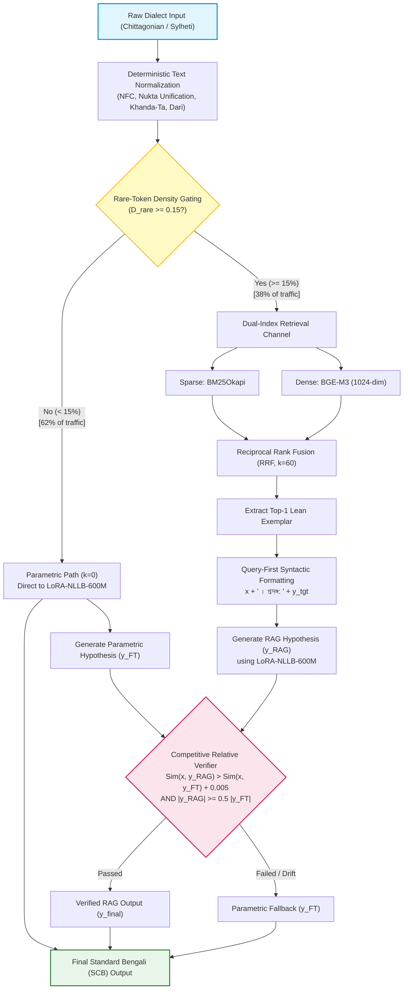

# Bridging Parametric Learning and Dynamic Non-Parametric Retrieval: A Verified Framework for Bangla Dialect Translation

[](https://www.python.org/downloads/)
[](https://pytorch.org/)
[](https://huggingface.co/)
[-orange)](https://github.com/huggingface/peft)
[](LICENSE)
[](https://hstu.ac.bd/)

> **Undergraduate Thesis (Course No.: ECE 452)**  
> Department of Electronics and Communication Engineering  
> **Hajee Mohammad Danesh Science and Technology University (HSTU)**, Dinajpur-5200, Bangladesh  
> *October 2026*

---

## 📌 Abstract & Overview

Bengali regional varieties like **Chittagonian** (~13M speakers) and **Sylheti** (~11M speakers) diverge sharply from Standard Colloquial Bengali (SCB) in phonology, morphosyntax, and vocabulary. Conventional Machine Translation (MT) encounters two major bottlenecks:
1. **The Context-Pollution Dilemma in Seq2Seq**: Naive multi-exemplar RAG collapses compact encoder-decoder models (e.g., NLLB drops to 3.02 BLEU) due to cross-attention disruption and positional embedding exhaustion.
2. **Pure Parametric Misses**: Standalone fine-tuning struggles on long-tail, uncodified dialectal lexemes and non-standard orthography.

This repository implements the **Architecture-Aware Lean Adaptive RAG Framework**, bridging parameter-efficient fine-tuning (LoRA on NLLB-200-Distilled-600M) with dynamic sparse-dense retrieval and relative hypothesis verification.

### 🌟 Key Highlights
- 🏆 **State-of-the-Art Translation**: **55.46 BLEU-4** overall (**60.02** on Chittagonian, **51.14** on Sylheti) and **91.24% BERTScore-F1**, outperforming 7B LLMs.
- ⚡ **Ultra-Efficient Edge Footprint**: Only **2.36M trainable parameters (0.38%)**; runs end-to-end within **~3.1 GB GPU VRAM** (deployable on a single Tesla T4 or consumer RTX GPU).
- 🛡️ **Zero-Leakage Benchmark**: Rigorously audited 80:10:10 stratified split across 17,040 parallel pairs (**0.0000% test-to-train data leakage** verified via MinHash LSH and SHA-256 cluster hashing).
- 🔄 **Safe Fallback Architecture**: A competitive relative verifier enforces an empirical performance lower bound ($\delta \ge 0.005$), mathematically guaranteeing that retrieval never degrades parametric quality.

---

## 🏗️ System Architecture



---

## 🔬 Core Innovations

### 1. Deterministic Text Canonicalization
Resolves graphemic ambiguity across crowdsourced text and OCR scans:
- **NFC Decomposition & Recomposition**: Unifies visually identical byte streams.
- **Nukta Unification**: Maps decomposed consonants `[ড, ঢ, য] + U+09BC` into canonical precomposed glyphs (`ড়` U+09DC, `ঢ়` U+09DD, `য়` U+09DF).
- **Word-Boundary Khanda-Ta**: Maps `ত` + Hasanta (`্`) at word boundaries to `ৎ` (U+09CE).
- **Bivariate Length Filtering**: Enforces $0.33 \le r_{\text{word}}, r_{\text{char}} \le 3.00$ to eliminate truncation noise.

### 2. Dynamic Lexical Density Gating
Prevents prompt pollution on routine sentences:
$$D_{\text{rare}}(x) = \frac{\sum_{w \in x} \mathbb{I}(w \in \mathcal{G}_{\text{dialect}})}{|x|}$$
- If $D_{\text{rare}}(x) < 0.15$: Routes directly through pure parametric generation (bypasses retrieval across ~62% of queries).
- If $D_{\text{rare}}(x) \ge 0.15$: Triggers lean single-exemplar retrieval.

### 3. Query-First Syntactic Formatting
Resolves positional embedding decay and query truncation in Seq2Seq decoders:
$$\tilde{x} = x \circ \text{" । প্রসঙ্গ: "} \circ y_{\text{tgt}}$$
Positions the source dialect sentence $x$ at indices $0 \dots L_{\text{query}}-1$, keeping the encoder attention focused on the query while treating the exemplar as a soft modifier.

### 4. Competitive Relative Faithfulness Verification
Acts as a dynamic safety governor against distractor exemplars:
$$\hat{y}_{\text{final}} = \begin{cases} 
\hat{y}_{\text{RAG}} & \text{if } \text{Sim}(x, \hat{y}_{\text{RAG}}) > \text{Sim}(x, \hat{y}_{\text{FT}}) + \delta \;\land\; |\hat{y}_{\text{RAG}}| \ge 0.5 \cdot |\hat{y}_{\text{FT}}| \\ 
\hat{y}_{\text{FT}} & \text{otherwise} 
\end{cases}$$
Where $\delta = 0.005$. If retrieval introduces semantic drift or truncation, the system automatically falls back to $\hat{y}_{\text{FT}}$.

---

## 📊 Experimental Results

Evaluated on the **Kothon Test Benchmark ($N = 1,704$)** across 10 evaluation metrics:

| Model Architecture | Model Type | Parameters | VRAM | Chittagonian (BLEU-4) | Sylheti (BLEU-4) | Overall BLEU-4 | chrF++ | BERTScore-F1 (%) |
| :--- | :---: | :---: | :---: | :---: | :---: | :---: | :---: | :---: |
| **BanglaT5** (Zero-Shot) | Seq2Seq | 247M | ~1.2 GB | 1.91 | 1.90 | 1.91 | 8.40 | 60.94 |
| **M2M100-418M** (Zero-Shot) | Seq2Seq | 418M | ~1.8 GB | 13.37 | 9.52 | 11.31 | 23.42 | 76.02 |
| **NLLB-600M Base** (Zero-Shot) | Seq2Seq | 619M | ~2.4 GB | 26.92 | 21.27 | 23.94 | 36.45 | 81.93 |
| **Qwen2.5-7B** (Zero-Shot) | Causal LLM | 7.6B | ~14.8 GB | 28.53 | 21.58 | 24.98 | 40.00 | 82.87 |
| **Qwen2.5-7B** (Hybrid-RAG, $k=4$) | Causal LLM | 7.6B | ~14.8 GB | 50.77 | 34.08 | 41.83 | 56.22 | 86.76 |
| **NLLB-600M** (Static RAG) | Seq2Seq | 619M | ~2.4 GB | 3.27 | 2.81 | 3.02 | 19.62 | 61.44 |
| **Proposed FT-NLLB + Adaptive RAG + Verifier** | **Seq2Seq + LoRA** | **619M (2.36M trainable)** | **~3.1 GB** | **60.02** | **51.14** | **55.46** | **61.46** | **91.24** |

### Key Takeaway
- Outperforms zero-shot NLLB-600M by **+31.52 BLEU-4 (+131.7% relative)**.
- Outperforms 7B Qwen2.5-7B Hybrid-RAG by **+13.63 BLEU-4** while requiring **79% less VRAM** (~3.1 GB vs ~14.8 GB).

---

## 📂 Repository Structure

```text
├── configs/
│   ├── lora_config.json            # LoRA hyperparameters (r=16, alpha=32)
│   └── training_args.yaml          # FP32/BF16 training protocol config
├── data/
│   ├── kothon_splits/              # Leak-free 80:10:10 dataset splits
│   └── gloss_dictionaries/         # Top 2,000 statistical bilingual lexicons
├── src/
│   ├── canonicalization/
│   │   ├── normalizer.py           # Unicode NFC, Nukta, Khanda-Ta canonicalization
│   │   └── guardrails.py           # Bivariate length ratio (0.33 - 3.00) filtering
│   ├── retrieval/
│   │   ├── bm25_indexer.py         # BM25Okapi sparse retrieval
│   │   ├── dense_indexer.py        # BGE-M3 1024-dimensional dense indexing
│   │   └── rrf_fusion.py           # Reciprocal Rank Fusion (k=60)
│   ├── models/
│   │   ├── gating.py               # Lexical density gating (threshold = 0.15)
│   │   ├── modeling_nllb_lora.py   # LoRA-adapted NLLB-200 architecture
│   │   └── verifier.py             # Competitive relative faithfulness verifier
│   └── pipeline.py                 # End-to-end verified inference pipeline
├── scripts/
│   ├── train_lora.py               # Training script with FP32 Master / BF16
│   ├── build_indices.py            # FAISS + BM25 index generator
│   └── evaluate_metrics.py         # 10-metric evaluation suite
├── requirements.txt
└── README.md
```

---

## 🚀 Quickstart & Usage

### 1. Installation
```bash
git clone https://github.com/YOUR_USERNAME/bangla-dialect-translation.git
cd bangla-dialect-translation

# Create virtual environment
python -m venv venv
source venv/bin/activate  # On Windows: venv\Scripts\activate

# Install dependencies
pip install -r requirements.txt
```

### 2. Quick Inference Example
```python
from src.pipeline import VerifiedDialectTranslator

# Initialize translator (runs on a single GPU or CPU)
translator = VerifiedDialectTranslator.from_pretrained(
    base_model="facebook/nllb-200-distilled-600M",
    lora_weights="checkpoints/lora-nllb-kothon",
    bm25_index="data/indices/bm25.pkl",
    dense_index="data/indices/bge_m3_faiss.index",
    device="cuda"
)

# Translate Chittagonian
text_ctg = "খাল্া, আঁই এহতনা ন জানি ।"
result = translator.translate(text_ctg, dialect="chittagonian")
print(result["translation"])
# Output: "খালা, আমি এখনো জানি না।"
print(f"Path taken: {result['path']}, Verification Margin: {result['margin']}")

# Translate Sylheti
text_syl = "আমি তো লাফও দিতাম পারি।"
result = translator.translate(text_syl, dialect="sylheti")
print(result["translation"])
# Output: "আমি তো লাফও দিতে পারি।"
```

### 3. Training LoRA Adapters
```bash
python scripts/train_lora.py \
    --base_model facebook/nllb-200-distilled-600M \
    --train_data data/kothon_splits/train.jsonl \
    --val_data data/kothon_splits/val.jsonl \
    --output_dir checkpoints/lora-nllb-kothon \
    --lora_rank 16 \
    --lora_alpha 32 \
    --fp32_master_bf16 True \
    --batch_size 4 \
    --gradient_accumulation_steps 8 \
    --epochs 4
```

---

<!-- ## 📖 Citation

If you find this research or code useful in your work, please cite our undergraduate thesis:

```bibtex
@thesis{hstu_ece_dialect_2026,
  author       = {Student ID: 2102112 and Student ID: 2102129 and Student ID: 2102155},
  title        = {Bridging Parametric Learning and Dynamic Non-Parametric Retrieval: A Verified Framework for Bangla Dialect Translation},
  school       = {Department of Electronics and Communication Engineering, Hajee Mohammad Danesh Science and Technology University (HSTU)},
  year         = {2026},
  month        = {October},
  address      = {Dinajpur-5200, Bangladesh},
  type         = {Bachelor of Science in Electronics and Communication Engineering Thesis},
  note         = {Course No.: ECE 452}
}
``` -->

---

## 👥 Authors & Acknowledgments

- **Undergraduate Researchers**:
  - Student ID: `2102112`
  - Student ID: `2102129`
  - Student ID: `2102155`
  - *Session: 2021*
- **Affiliation**: [Department of Electronics and Communication Engineering (ECE)](https://hstu.ac.bd/), Hajee Mohammad Danesh Science and Technology University (HSTU).
- **Gratitude**: We dedicate this work to our beloved parents and acknowledge the creators of the **Kothon benchmark** and open-source models (Meta AI's NLLB, BAAI's BGE-M3).